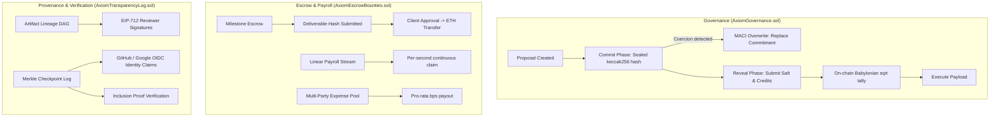

# Axiom Protocol

A decentralized coordination stack for DAO payroll, anti-collusion governance, and deliverable provenance. Built for Hackathon Track 3.

---

## Why we built this

Most DAOs with tens of millions in their treasury still run their operations on fragile Web2 setups:
- **Snapshot votes get bought or gamed**: Because votes are public in real-time, flashloans and bribe cartels can verify vote purchases before the block even confirms. Voters herd behind whichever whale votes first.
- **Grant payouts are either lump-sum or trust-based**: DAOs either wire 50k USDC upfront and pray the team doesn't vanish, or use centralized payroll vendors (Deel, Gusto) that defeat the purpose of trustless organizations.
- **Working group deliverables get lost in Discord**: Reports, audits, and Git tags get dropped into channel threads with no immutable record of who authorized what version.

Axiom replaces these trust assumptions with straightforward smart contracts on EVM:
1. **Commit-Reveal Quadratic Voting with MACI Overwrites**: Hides ballot distribution until the reveal phase so vote-buying markets can't clear. If a contributor is coerced into voting a specific way, they can overwrite their commitment before the deadline.
2. **Milestone Escrow & Linear Salary Streams**: Locks grant funds on-chain; releases payouts only when contributors submit verifiable artifact hashes ($\text{SHA-256} / \text{IPFS CID}$) and clients sign off. Includes per-second streaming for ongoing core payroll.
3. **Multi-Party Expense Pools**: Split joint team expenses (booths, audits, compute) across multiple addresses by basis points without running multiple transactions.
4. **DAG Provenance & Keyless OIDC Attestations**: Tracks revision lineage ($v1 \to v2 \to v3$) via parent-hash pointers. Non-crypto contributors can sign deliverables using their existing GitHub or Google Workspace identities.

---

## Architecture



---

## Technical Details

### 1. Anti-Collusion Commit-Reveal Math
During the commit window, a voter submits:
$$\text{Commitment} = \text{keccak256}(\text{proposalId}, \text{voterAddress}, \text{choice}, \text{credits}, \text{salt})$$

Because the 32-byte salt is held locally by the voter, an external briber cannot confirm how the voter voted. Quadratic voting is calculated on-chain during reveal using an integer square root routine (Babylonian method):
$$\text{Effective Votes} = \lfloor\sqrt{\text{Credits}}\rfloor$$

**Whale resistance comparison**:
- A whale with 400 credits gets $\lfloor\sqrt{400}\rfloor = 20$ votes.
- 4 contributors with 100 credits each get $4 \times \lfloor\sqrt{100}\rfloor = 40$ votes.
- The community coalition wields $2\times$ the voting power of the single whale despite having fewer total credits ($300 < 400$).

### 2. MACI Coercion Resistance
If an attacker demands proof of a specific vote or watches over someone's shoulder, the voter commits the attacker's required hash. Later, before the commit phase closes, the voter invokes `overrideCoercedBallot(proposalId, newCommitment)`. The contract overwrites the stored commitment. When the reveal phase opens, the attacker's salt fails to unpack, while the voter's authentic ballot is counted.

### 3. Keyless OIDC Attestations
Non-crypto contributors often do not maintain hardware wallets. `AxiomTransparencyLog.sol` accepts identity hashes certified by OIDC JSON Web Token (JWT) relayers (e.g., `github:user:username` or `google:user@domain.org`), binding real developer identities to deliverable hashes without requiring personal private keys.

---

## Contracts & Local Deployments

Compiled with Solidity 0.8.24 on the Cancun EVM target (`viaIR: true`, 200 optimizer runs).

| Contract | Local Address | Purpose |
|:---|:---|:---|
| **`AxiomGovernance`** | `0x5FbDB2315678afecb367f032d93F642f64180aa3` | Commit-reveal quadratic voting, conviction signaling, MACI ballot overwrite |
| **`AxiomEscrowBounties`** | `0xe7f1725E7734CE288F8367e1Bb143E90bb3F0512` | Milestone escrow, per-second payroll streaming, multi-party expense splits |
| **`AxiomProvenanceRegistry`** | `0x9fE46736679d2D9a65F0992F2272dE9f3c7fa6e0` | Version DAG lineage tracking, EIP-712 reviewer attestations |
| **`AxiomTransparencyLog`** | `0xCf7Ed3AccA5a467e9e704C703E8D87F634fB0Fc9` | Merkle inclusion proofs, GitHub & Google OIDC identity claims |

---

## Test Suite

```bash
# Run unit & invariant test suite
npm test
```

```text
  AxiomEscrowBounties Protocol
    ✔ should create milestone project, submit deliverable hash, and release milestone payment
    ✔ should create and disburse a multi-party expense sharing pool
    ✔ should create and complete a role-based task bounty
    ✔ should support continuous streaming payroll

  AxiomGovernance Protocol
    ✔ should create a proposal with commit and reveal durations
    ✔ should enforce Commit-Reveal secret ballot and Quadratic Voting formula
    ✔ should support MACI anti-coercion ballot overwrite
    ✔ should create conviction signals and accumulate time-weighted support

  AxiomProvenance & TransparencyLog Protocol
    ✔ should register digital artifacts and trace DAG version lineage
    ✔ should verify EIP-712 typed structured attestations
    ✔ should commit Merkle checkpoints and verify off-chain inclusion proofs
    ✔ should record and retrieve Keyless OIDC Attestations (GitHub/Google identity sign-offs)

  12 passing (543ms)
```

---

## Running the Web App

The app includes built-in mock accounts (`treasury.dao.eth`, `0xresearcher.eth`, `auditor-charlie.eth`), an on-chain EVM clock accelerator, and support for injected wallets (MetaMask / Rabby).

```bash
# 1. Install root dependencies & compile
npm install
npm run compile

# 2. Start frontend dev server
cd frontend
npm install
npm run dev
```

Open **http://localhost:5173** in your browser.

---

## Engineering Trade-offs & Limitations

- **Commit-Reveal Gas Costs**: Commit-reveal requires two transactions per voter (commit hash, then reveal data). For high-frequency small votes, off-chain EIP-712 signaling or rollup-based MACI circuits (Groth16/Plonk) are cheaper; for treasury allocations ($>\$20\text{k}$), on-chain commit-reveal is well worth the gas to prevent flash-loan exploits.
- **OIDC Identity Relayer Trust**: Current implementation maps OIDC claims through an oracle/relayer signature into the transparency log. A production deployment would ideally verify RSA-SHA256 signatures of Google/GitHub JWKs directly in a ZK circuit (e.g. zk-email / OpenID ZK verifier).
- **Square Root Precision**: `_sqrt()` uses an integer Babylonian algorithm. Residual fractions of tokens are truncated, which slightly favors voters who allocate square amounts ($1, 4, 9, 16, 25, \dots$).
