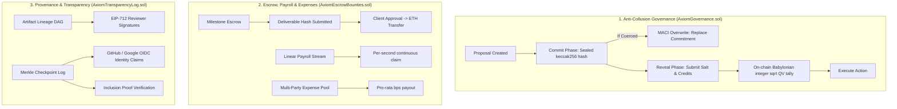

# Axiom Protocol

**Track Applied For:** Track 3: Decentralized Coordination Layers & Verifiable Governance  
**Team Name:** Axiom Collective  
**Team Members:** Enky-yy 
**GitHub Repository:** https://github.com/Enky-yy/Devcon-Track3  
**Live Demo / Deployed Contract:** Local: `http://localhost:5173` | Local Testnet Deployments:
- `AxiomGovernance`: `0x5FbDB2315678afecb367f032d93F642f64180aa3`
- `AxiomEscrowBounties`: `0xe7f1725E7734CE288F8367e1Bb143E90bb3F0512`
- `AxiomProvenanceRegistry`: `0x9fE46736679d2D9a65F0992F2272dE9f3c7fa6e0`
- `AxiomTransparencyLog`: `0xCf7Ed3AccA5a467e9e704C703E8D87F634fB0Fc9`  
<!--**Demo Video:** [Loom / YouTube Link (max 2 mins)]  -->

---

## 1. Problem Statement & Overview

### What specific problem does this project solve?
Coordinating groups at scale in Web3 remains constrained by centralized tooling (Discord, Telegram, Snapshot gateways), collusion-heavy voting systems, and untracked off-chain actions:
1. **Collusion & Vote Buying in DAOs**: Because standard on-chain or Snapshot votes are publicly visible in real-time, flash-loan bribers and dark DAOs can cryptographically verify vote purchases before a block confirms. Unshielded voting also causes herd voting, where participants blindly follow whichever whale casts the first ballot.
2. **Custodial & Trust-Heavy Payouts**: DAOs either wire grant funds upfront with zero deliverable guarantees or rely on centralized SaaS payroll intermediaries (Deel, Gusto), reintroducing custodial single points of failure.
3. **Loss of Provenance & Attribution**: Working group research papers, security audits, and release artifacts are scattered across Discord threads or Google Drives with no tamper-proof lineage, no immutable record of review sign-offs, and no bridge for Web2 developer identities (GitHub/Google) without hardware wallets.

### Who is the intended user or protocol beneficiary?
- **DAOs & Grant Councils**: Deploying treasury capital through milestone-gated escrow and Sybil-resistant quadratic voting.
- **Core Working Groups & Contributors**: Streaming real-time salaries by the second and splitting shared expenses (booths, audits, compute) trustlessly without centralized bookkeeping.
- **Researchers, Auditors & Developers**: Publishing deliverables with cryptographic provenance DAGs and attesting to artifacts using Web3 keys or keyless Web2 developer identities.

---

## 2. Architecture & Technical Flow

### How does the system work under the hood?
Axiom is built as four composable EVM smart contract modules:
1. **`AxiomGovernance.sol` (Anti-Collusion & Quadratic Voting)**:
   - **Commit-Reveal Mechanism**: Ballots are submitted as sealed hashes $\text{keccak256}(\text{proposalId}, \text{voter}, \text{choice}, \text{credits}, \text{salt})$. Vote distributions remain completely hidden during voting.
   - **MACI Anti-Coercion Overwrite**: If a contributor is coerced or bribed in-person, they can invoke `overrideCoercedBallot(proposalId, newCommitment)` before the commit window closes. The previous ballot is overwritten; during reveal, the briber's hash fails to unseal while the authentic vote is tallied.
   - **On-Chain Quadratic Voting**: Tallied on-chain via an integer square root algorithm ($\text{Votes} = \lfloor\sqrt{\text{Credits}}\rfloor$), giving 4 contributors with 100 credits ($4 \times 10 = 40$) double the voting power of a single 400-credit whale ($\sqrt{400} = 20$).
2. **`AxiomEscrowBounties.sol` (Milestone Escrow, Payroll & Expense Sharing)**:
   - **Milestone Escrow**: Funds are locked on-chain. Contributors submit deliverable hashes ($\text{SHA-256} / \text{IPFS CID}$). Funds release upon client verification.
   - **Continuous Streaming Payroll**: Salaries stream linearly per second based on elapsed block timestamps (`claimSalaryStream()`).
   - **Multi-Party Expense Sharing**: Pools joint expenses across multiple addresses by basis points ($10{,}000 = 100\%$) and disburses pro-rata in a single transaction.
3. **`AxiomProvenanceRegistry.sol` (Artifact Lineage & EIP-712 Attestations)**:
   - Tracks version lineage as a Directed Acyclic Graph (DAG) with immutable parent-hash pointers ($v1 \to v2 \to v3$).
   - Records reviewer sign-offs via EIP-712 typed structured signatures.
4. **`AxiomTransparencyLog.sol` (Merkle Checkpoints & Keyless OIDC Attestations)**:
   - Anchors cryptographic checkpoints via OpenZeppelin `MerkleProof`.
   - Records Keyless OIDC identity claims (GitHub OAuth / Google Workspace) inspired by Sigstore, enabling non-crypto engineers to sign off on deliverables without holding private keys.

### Key protocols, tools & SDKs used:
- **Smart Contracts**: Solidity `0.8.24` (Cancun EVM target, `viaIR: true`, 200 optimizer runs).
- **Framework & Testing**: Hardhat, Ethers.js v6, OpenZeppelin Contracts (`MerkleProof`, `ECDSA`, `EIP712`, `ReentrancyGuard`).
- **Identity & Provenance**: EIP-712 structured data hashing, Sigstore-style keyless OIDC identity claim logging.
- **Frontend Stack**: React 19, TypeScript, Vite, Lucide Icons, pure neutral carbon/slate design system.

### Architecture Diagram


---

## 3. Key Accomplishments (48-Hour Scope)

### What features are 100% working and testable today?
- **12/12 Passing Smart Contract Test Suite**: Comprehensive unit and invariant tests passing in `<600ms` via Hardhat.
- **Anti-Collusion Commit-Reveal & MACI Overwrite**: Full lifecycle functional on-chain. Sealed commitments cannot be read; ballot overwrites replace earlier submissions; reveal tallies votes quadratically.
- **Live Quadratic Voting Math Engine**: On-chain $\lfloor\sqrt{\text{credits}}\rfloor$ calculation verified against whale voter scenarios.
- **Milestone-Based Escrow & Per-Second Streaming Payroll**: Milestone creation, deliverable hash anchoring, milestone release, and continuous per-second payroll streaming.
- **Multi-Party Expense Sharing**: Expense pool creation and multi-beneficiary basis-point disbursement in a single transaction.
- **Cryptographic Provenance DAG & EIP-712 Attestations**: Parent-hash lineage tracking across versions and typed structured signature verification.
- **On-Chain Merkle Inclusion Proofs**: Merkle root checkpoint anchoring and interactive client-side leaf tampering detector.
- **Keyless OIDC Attestation Log**: Sigstore-style identity bindings associating GitHub and Google identities to deliverable hashes.
- **Interactive Minimalist Web dApp**: Production-grade React/TypeScript frontend with live wallet connection, 3 preset test personas, EVM clock accelerator, and zero external SaaS dependencies.

### What mockups or simulated fallbacks were used?
- **OIDC Identity Relayer**: In this hackathon build, OIDC identity claims (GitHub/Google) are submitted via an attestation relayer signature. A full production implementation would verify raw RSA-SHA256 signatures of OIDC Json Web Keys (JWKs) on-chain using a ZK circuit (e.g., zk-email / OpenID ZK verifier).
- **Time Accelerator**: Since commit and reveal phases require specific block timestamp elapsed intervals, the UI includes an EVM clock fast-forward utility (`+10m Commit -> Reveal`, `+25m End Voting`) for live judge demonstration.
- **Local Fallback Storage**: If connected without a local RPC node, the frontend gracefully falls back to responsive demo mock state so judges can test all interactions without configuring a local blockchain.

---

## 4. Setup & Local Reproduction Instructions

### Prerequisites
- Node.js `v18+` or `v20+`
- npm `v9+`

### Step-by-Step Reproduction

```bash
# 1. Clone the repository
git clone https://github.com/Enky-yy/Devcon-Track3.git

# 2. Navigate to the project root
cd Devcon-Track3

# 3. Install contract dependencies
npm install

# 4. Compile smart contracts (Solidity 0.8.24 viaIR)
npm run compile

# 5. Run smart contract test suite (12 tests)
npm test
```

Expected Test Output:
```text
  AxiomEscrowBounties Protocol
    ✔ should create milestone project, submit deliverable hash, and release milestone payment
    ✔ should create and disburse a multi-party expense sharing pool
    ✔ should create and complete a role-based task bounty
    ✔ should support continuous streaming payroll

  AxiomGovernance Protocol
    ✔ should create a proposal with commit and reveal durations
    ✔ should enforce Commit-Reveal secret ballot and Quadratic Voting formula
    ✔ should support MACI anti-coercion ballot overwrite
    ✔ should create conviction signals and accumulate time-weighted support

  AxiomProvenance & TransparencyLog Protocol
    ✔ should register digital artifacts and trace DAG version lineage
    ✔ should verify EIP-712 typed structured attestations
    ✔ should commit Merkle checkpoints and verify off-chain inclusion proofs
    ✔ should record and retrieve Keyless OIDC Attestations (GitHub/Google identity sign-offs)

  12 passing (543ms)
```

### Launching the Frontend Application

```bash
# 1. Navigate to frontend directory
cd frontend

# 2. Install frontend dependencies
npm install

# 3. Start local development server
npm run dev
```

Open **http://localhost:5173** in your browser.

### Quick Judge Walkthrough
1. Click the **"Protocol Walkthrough"** button in the navigation bar to run an interactive 4-step protocol simulation.
2. In the **Anti-Collusion Governance** tab:
   - Click **"Commit Ballot"** on AIP-1 to submit a sealed ballot.
   - Click **"MACI Override"** to simulate quietly overriding a coerced ballot before reveal.
   - Click **"+10m (Reveal Phase)"** in the top bar, then click **"Reveal Vote"** to watch the quadratic vote tally ($\sqrt{\text{credits}}$) calculate live.
3. In the **Bounty Escrow & Payroll** tab:
   - View the live per-second salary stream ticking in real time and click **"Claim Accrued Payout"**.
   - Inspect milestone deliverables and disburse the multi-party expense pool.
4. In the **Transparency & Merkle Log** tab:
   - Select leaves in Checkpoint #1 and toggle **"Simulate Tamper"** to watch cryptographic proof verification dynamically detect data corruption.
   - Click **"Record Keyless Attestation"** to anchor a deliverable sign-off with a GitHub or Google identity.
